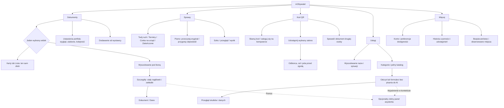

# mObywatel — mapa produktu i pokrycie funkcji

Stan wersji R36: 25 października 2026. Horyzont koncepcji: 2028. Opis pokrycia lokalnego produktu; konkretne wykonane sprawdzenia i granice podaje bieżący rejestr QA.

## Decyzja produktowa

Budujemy cyfrowy portfel i miejsce prowadzenia spraw obywatela. Zachowujemy dostęp do dokumentów i usług; upraszczamy sposób ich odnajdywania i obsługi. Rozmowa jest dodatkową pomocą przy zadaniu. Nie jest warunkiem skorzystania z katalogu, przeczytania pisma ani wypełnienia formularza.

Nie uzasadniamy projektu tezą, że obecny mObywatel wymaga czatu. To prototyp konkursowy eksperymentuje z rozmową. Rzeczywisty mObywatel już ma portfel, wiele usług, przypomnienia i statusy. Sama obecność tych elementów nie jest naszą innowacją.

## Trzy różne punkty odniesienia

| Źródło | Co sprawdzono | Co wolno z tego wywnioskować |
|---|---|---|
| Oryginał konkursowy | Działający publiczny portfel i szczegóły; kod pobranego prototypu, scenariusze oraz definicje narzędzi | Zakres zamierzonej demonstracji i sposób dojścia do funkcji. Narzędzie w kodzie nie jest automatycznie gotową usługą |
| Rzeczywisty mObywatel | Aktualne oficjalne katalogi w przeglądarce, opisy COI/MC, materiały Google Play | Nazwy i opisy obecnych możliwości. Nie jest to test aplikacji z kontem obywatela na telefonie |
| Nasz projekt | Źródła, działające ekrany, osobne recenzje, testowe dane skali, testy narzędzi | Konkretne działanie lokalnego prototypu. Nie dowodzi integracji z rejestrami, kwalifikowanego podpisu ani certyfikacji e-ID |

W oficjalnym katalogu odczytanym w przeglądarce było **32 rodzajów dokumentów i 37 usług**. Rodzaj dokumentu nie oznacza dokumentu posiadanego przez każdego użytkownika. Marketingowe obrazy w Google Play mogą być starsze od daty aktualizacji aplikacji; jeden z oglądanych ekranów miał datę z lipca 2025. Nie używamy go jako dowodu dokładnej nawigacji na październik 2026. [Dokumenty](https://info.mobywatel.gov.pl/dokumenty), [usługi](https://info.mobywatel.gov.pl/uslugi), [Google Play](https://play.google.com/store/apps/details?id=pl.nask.mobywatel&hl=pl).

## Mapa pięciu głównych miejsc

Pięć miejsc wynika z najnowszej referencji dostarczonej przez użytkownika i szerokości zakresu. „Więcej” nie jest magazynem usług, dokumentów i scenariuszy pokazowych. Zawiera konto, prywatność, historię i preferencje. Historia ma osobny ekran; nie jest już obowiązkową trzecią zakładką dla każdego.

## Zadania, które organizują interfejs

| Sytuacja / JTBD | Najkrótsze sensowne wejście | Informacja potrzebna do decyzji | Czego nie wymagać |
|---|---|---|---|
| Mam okazać dokument | Dokumenty → wybrana karta | Nazwa, posiadacz, zakres i właściwa ważność | Pisania „pokaż dowód” |
| Potrzebny tylko dowód pełnoletności | Kod QR → pełnoletność | Co ujawniam, komu i czego odbiorca nie dostaje | Automatycznego ujawnienia PESEL |
| Mam sprawdzić cudzy dokument | Kod QR → przyjmij dane | Czyje dane otrzymuję i w jakim celu | Szukania w OC lub punktach karnych |
| Nie pamiętam nazwy dokumentu | Dokumenty → wyszukiwanie / Lista | Nazwa i status, bez powtarzania pełnego awersu | Ustawień → Dokumentów → Wszystkich |
| Chcę zmienić portfel pod siebie | Dokumenty → ustawienia portfela | Wybrane karty i ich kolejność | Gestu przeciągania jako jedynej metody |
| Dostałem pismo | Sprawy → pismo → przeczytaj | Oryginał, termin, nadawca | Przechodzenia od razu do podpisu |
| Mam odpowiedzieć | Sprawy → pismo → odpowiedź | Adresat, treść, konkretne załączniki i wynik | Akceptowania automatycznie dodanych faktur |
| Zgubiłem dokumenty | Usługi → utrata / ochrona danych | Różnica między zastrzeżeniem, zawieszeniem i unieważnieniem | Jednego nieodwracalnego „napraw wszystko” |
| Sprawdzam auto przed zakupem | Usługi → historia pojazdu | Dane tego pojazdu, nie własnego auta | Zgadywania pytania do modelu |
| Potrzebuję recepty | Usługi → Recepty | Osoba, lek, termin i zakres dostępu | Czatowania dla prostego odczytu |
| Mam wiele spraw | Sprawy → lista i wyszukiwanie | Status, termin i następny krok | Kolejnych dużych kafli na każdą sprawę |
| Chcę wrócić do udostępnienia | Więcej → Historia | Odbiorca, zakres i znany czas | Przeglądania zapisów pogody między zgodami |

## Co rzeczywiście zostało zachowane

Z oryginalnego backendu zinwentaryzowano **66 definicji narzędzi: 33 odczyty, 27 akcji i 6 operacji UI**. To techniczna liczba, nie wynik 66 testów usług. Pełna macierz zawiera każdy identyfikator, jego opis i przypisany obszar JTBD: [macierz 66 narzędzi](audyt-pokrycia/macierz-66-narzedzi.csv).

Po pierwszym audycie samo pozostawienie narzędzia za czatem uznaliśmy za niewystarczające. Druga iteracja dodaje wspólne formularze i karty wyników dla istniejącego fikcyjnego świata prototypu. Formularz odczytu, podgląd działania i potwierdzenie są osobnymi operacjami. Nazwa operacji i jej dane po przeglądzie są związane z jednorazowym tokenem; zmiana parametrów w żądaniu potwierdzenia nie podmienia zatwierdzanej czynności.

Nie wszystkie pozycje oficjalnego katalogu mają odpowiednik w pobranym prototypie. Nie dopisujemy fikcyjnego dostępu do rejestru tylko po to, aby zgadzała się liczba kafelków. Te braki trzeba pokazać w macierzy jako zakres dalszej integracji. Podpis wybranego własnego PDF-u jest podglądem i przygotowaniem, nie kryptograficznym podpisaniem pliku.

## Dokumenty przy większej skali

Dokumenty pokazują **jedną pełną kolekcję**, każdy dokument raz. Karty i Lista zmieniają sposób prezentacji tego samego zbioru. Nie ma limitu czterech ulubionych ani przełączenia do innego zakresu przy większej liczbie dokumentów. Ulubione są rozłączną grupą na początku kolekcji; pozostałe dokumenty nadal są niżej. Ikona koła zębatego otwiera „Ustawienia portfela”: dodanie dokumentu, wybór wyglądu oraz zwiniętą sekcję ulubionych i kolejności. Ekran główny nie ma już przełącznika widoku ani dodatkowej gwiazdki. Wyszukiwanie otwiera ikona; Escape czyści filtr i wraca do ikony. Sprawy nie są dokładane do portfela jako wypełniacz.

Długi tytuł pozostaje nazwą dokumentu. Nieznany typ nie może stawać się automatycznie „Legitymacją” ani dziedziczyć działań KDR. Nowy dokument wymaga określonego wystawcy, statusu, pól i dozwolonych działań. Kolor klasyfikuje dokument; nie jest dowodem ważności.

Dodawanie w lokalnym scenariuszu korzysta z przykładowej legitymacji służbowej z dostarczonej referencji. Jest to rozszerzenie fikcyjnych danych demonstracji, nie ustalenie uprawnień prawdziwej osoby ani integracja pracodawcy. „Brak dokumentu u wystawcy”, „już w portfelu” i „dostępność niepotwierdzona” mają odmienne znaczenie.

Osobny widok QA obejmuje zbiory 1/4/12/**20**/30 dokumentów. Przypadek Jana zawiera dwa odrębne pojazdy; wybór konkretnego auta prowadzi do jego rejestracji, OC i terminu badania. W r3 sprawdzano rozdzielenie kolekcji od pojedynczego obiektu. Przegląd w ramce 320 px nie zastępuje testu na fizycznym telefonie, a liczba rekordów nie jest wynikiem testu wszystkich działań.

## Sprawy, skrzynka i usługi

Sprawa jest instancją zadania: ma kontekst, stan i kolejny krok. Usługa jest sposobem rozpoczęcia lub obsłużenia zadania. Dokument jest zasobem używanym w zadaniu. Wiadomość jest źródłem albo potwierdzeniem związanym ze sprawą. Nie tworzymy osobnego niepowiązanego kafla dla każdego z tych elementów.

Moduł `cases-ui.js` rozdziela **Twój ruch**, **Terminy**, **Czeka na urząd** oraz **Zakończone czynności**; osobno pokazuje wiadomości i własne przypomnienia. Filtry to Wszystkie / Twój ruch / Czeka na urząd / Zakończone, uzupełnione wyszukiwaniem. Terminy nie udają statusów urzędowych. „Czeka na urząd” pokazuje stan zapisany w lokalnym świecie po czynności, bez odczytu aktualnego etapu z państwowego systemu. Kategorie usług pozostają w Usługach.

Powrót z wyniku ma zachować zapytanie i kategorię. Powrót do formularza ma zachować szkic. Wysłana czynność powinna mieć rzeczywisty zapis wyniku w lokalnym świecie prototypu; samo wyświetlenie dymka „gotowe” nie jest takim zapisem.

## System ostrzeżeń

Ostrzeżenia mają swój kontekst: miejsce, wydawcę, czas, poziom i zalecenia. Zapisanie komunikatu do czytania bez sieci nie jest czynnością tej samej klasy co podpis albo zgoda na przekazanie danych. Zapisane ostrzeżenia pozostają w Bezpieczeństwie, poza domyślną historią czynności.

Najnowsza referencja wnosi dobry wzorzec przejścia od wczesnego ostrzeżenia do pilnego działania i odwołania. Nie należy jednak kopiować treści „Idź do schronu” jako rzeczywistego bieżącego komunikatu. „Jestem w bezpiecznym miejscu” oznacza najwyżej deklarację osoby; nie potwierdza bezpieczeństwa ani przekazania danych służbom.

Obecny działający moduł pobiera publiczne ostrzeżenia IMGW, pokazuje świeżość odczytu i zachowuje kopie. Nie jest systemem dostarczania alarmów RCB ani natywnych powiadomień na ekran blokady. Krytyczny alert systemowy z nowej referencji pozostaje osobnym zakresem koncepcji i testu, dopóki nie ma rzeczywistego źródła i ustalonej semantyki stanu.

## Nowe ścieżki i granice ich działania

| Obszar | Potwierdzone w bieżącym kodzie | Pozostająca granica |
|---|---|---|
| mStłuczka | Kwalifikacja sytuacji, wybór roli i konkretnego auta, dane drugiego kierowcy, opis, dwa osobne potwierdzenia, zapis oświadczenia; zgłoszenie szkody jako osobna czynność | Druga osoba i kod należą do scenariusza; brak rzeczywistego parowania telefonów, pieczęci i wysyłki do ubezpieczyciela |
| Zdjęcia i kopia oświadczenia | Zdjęcia JPG/PNG w IndexedDB, do 10 plików po 10 MB, odczyt ograniczony do profilu i zakresu; kopia otwierana do wydruku lub zapisu PDF | To lokalna kopia demonstracji, bez pieczęci elektronicznej i skutku prawnego; nie jest podpisanym plikiem |
| Odbiór dowodu / paszportu | Oddzielne narzędzia i numer wniosku odróżniony od numeru dokumentu | Dane scenariusza; komplet statusów i zachowanie błędów wymagają oceny ścieżki |
| KRS | Lista podmiotów i ról, szczegóły podmiotu, lokalna preferencja powiadomień | Zapis preferencji nie jest usługą PUSH; brak pliku odpisu w danych |
| MKA | Rozdział braku wydanej karty, dodania istniejącej karty do Dokumentów i szczegółów biletów | Brak autentycznego kodu kontrolnego od wystawcy; numer karty go nie zastępuje |
| Mandaty | Dedykowana lista i szczegóły, wskazanie płatności przelewem według mandatu, informacja o możliwym opóźnieniu danych | Nie jest to płatność mandatu w aplikacji ani potwierdzenie braku wszystkich zobowiązań |
| Umowa → PCC-3 | Odczyt przesłanego JPG/PNG/PDF, poprawialne pola z cytatem i numerem strony, potwierdzanie z oryginałem, warunki podatku i podgląd dalszej czynności | Ekstrakcja regułowa może pominąć lub źle rozpoznać pole; nie ustala samodzielnie zwolnienia ani wartości rynkowej i nie dowodzi złożenia deklaracji |
| Podpis dokumentu | Wybór własnego PDF-u, podgląd i wybór opisanego rodzaju podpisu | Bez podpisu kryptograficznego, NFC/CAN/PIN2, dostawcy podpisu i podpisanego pliku wynikowego |

Odczyt umowy wykonują `contract-ui.js`, `ocr.py` i `ocr.swift`: tekstowy PDF jest odczytywany przez PDFKit, a obrazy i skany przez **Apple Vision lokalnie na serwerze Mac**. Plik trafia do serwera aplikacji na czas odczytu, po czym plik tymczasowy jest usuwany. Pola i cytaty mogą pozostać w zapisanym szkicu. To rzeczywisty odczyt pliku i regułowa ekstrakcja, bez Bielika i bez generatywnego LLM; „lokalnie” nie oznacza tutaj koniecznie przeglądarki ani telefonu osoby.

## Pokrycie katalogu i podprocesów

[Macierz 37 usług](audyt-pokrycia/macierz-uslug-oficjalnych-37.csv) rozpisuje **143 podprocesy/JTBD**. Obecność wszystkich nazw w katalogu nie oznacza gotowości tych ścieżek. Macierz zachowuje braki i kryteria ponownej oceny; nowszy moduł może poprawić część wpisu bez zamknięcia całej usługi. [Synteza researchu](mobywatel_research_funkcji_2026.md) pozostaje punktem odniesienia dla zakresu.

Otwarte pozostają m.in. warianty reprezentacji osoby, rzeczywiste dokumenty wynikowe, pełne dane rejestrowe, gałęzie po wysłaniu, kanały zgłoszeń i powiadomień. Nie przypisano gotowości wszystkim 37 usługom ani wszystkim 143 podprocesom. 66 definicji narzędzi, 37 nazw usług i 143 podprocesy są różnymi jednostkami inwentaryzacji.

Nie ma podłączonego działającego generatywnego LLM ani pełnego toru STT/TTS. Panel pomocy i istniejące scenariusze rozmowy nie stanowią dowodu tych integracji. Odczyt umowy jest osobnym, lokalnym mechanizmem.

## Wspólny system projektowy

Interfejs ma pięć stałych miejsc, białe powierzchnie na chłodnym tle, nagłówki Instrument Sans oraz Inter w nowych wierszach i formularzach. Starsze elementy dziedziczą systemowy stos pisma z Inter jako alternatywą. Niebieski prowadzi działania, fiolet klasyfikuje prawo jazdy, zieleń KDR, a bursztyn pojazdy. Tożsamość zachowuje granatowo-kobaltowy gradient. Kolor dokumentu nie potwierdza jego ważności.

Szczegóły dokumentu zachowują nieruchomy nagłówek i zakładki; zmienia się treść pod nimi. Ogólna animacja wejścia zawartości została usunięta. Główna kolekcja prowadzi bezpośrednio do dokumentu; nie wymaga przekładania stosu kart. Historyczny selektor ma przerywalne przejścia, ale nie jest obecnym głównym wejściem. [Zwięzły opis systemu projektowego](mobywatel_design_system.md) zawiera role kolorów, typografię, komponenty i zasady stanów.

To własny system inspirowany Material 3. Nie deklarujemy natywnych komponentów Compose, pełnej zgodności z Material You ani pełnej walidacji WCAG.

## Co obejmowały recenzje

Przeprowadzono dwie rundy sześciu niezależnych perspektyw AI (**r1 i r2**) oraz celowane retesty r3 dla architektury informacji, mobile i zaufania. [Manifest r3](audyt-pokrycia/wersja-r3.json) i [recenzja IA](audyt-pokrycia/recenzja-1-r3.md), [mobile](audyt-pokrycia/recenzja-3-r3.md), [zaufania](audyt-pokrycia/recenzja-6-r3.md) wskazują konkretne pliki i zakres dowodów.

Celowane niezależne recenzje r5/r6/r7 opisują lokalną AI, odpowiedź, portfel i mStłuczkę. Dowody implementacyjne i recenzje pozostają odrębnymi plikami. Starsze werdykty dotyczą sprawdzonych wersji i uwag; nie zatwierdzają automatycznie późniejszych zmian. Nie ma podstaw do wyniku „100/100” ani deklaracji pełnej gotowości produktu.

## Wartość dla pokazu konkursowego

Teza projektowa: **„Pełny portfel i sprawy, które znajdujesz po swojej sytuacji. AI pomaga w zadaniu, a decyzję podejmujesz na widocznych danych.”**

Najmocniejszy moment nie wymaga efektownej rozmowy: wybierasz tylko pełnoletność, widzisz nadmiarowe żądanie odbiorcy, odmawiasz zbędnych pól; przy rozbieżności danych przekazanie zostaje zatrzymane. To pokazuje korzyść, kontrolę i granicę automatyzacji jednym działaniem.

Dla jury oceniającego usługę publiczną istotne będą: zachowanie zakresu mObywatela, samodzielność użytkownika, dostępność i wiarygodny plan integracji. Nie znamy preferencji ani pełnego składu jury. Nie obiecujemy wygranej i nie przedstawiamy hipotezy o łatwiejszej obsłudze jako wyniku badania.

Pokaz powinien trwać około trzech minut: dokument bez rozmowy → sprawa znaleziona w katalogu → przegląd danych lub zatrzymanie rozbieżności → powrót do zapisanego stanu. Plan testów z ludźmi musi porównać te same zadania i równoważne dane w obu wersjach, ze zmienianą kolejnością. Pomiar czasu jest pomocniczy; ważne są ukończenie, pomyłki i rozumienie skutku.

## Źródła i ograniczenia

Aktualność katalogów sprawdzono w działającej przeglądarce 25.10.2026. Dodatkowe źródła: [COI — mObywatel](https://www.coi.gov.pl/realizacje/mobywatel-2-0), [osobisty podpis PDF](https://info.mobywatel.gov.pl/uslugi/podpisz-dokument), [podpis kwalifikowany](https://info.mobywatel.gov.pl/aktualnosci/podpis-kwalifikowany-w-aplikacji), [mDyplomy](https://info.mobywatel.gov.pl/dokumenty/mdyplomy), [oryginał konkursowy](https://mobywatel.ai/prototyp).

Dostarczone pliki HTML i obrazy są materiałem projektowym, a nie dowodem obecnych możliwości prawdziwej aplikacji. Żadne przeprowadzone sprawdzenie nie jest badaniem reprezentatywnym, audytem natywnych aplikacji ani certyfikacją WCAG. Raporty sześciu agentów są niezależnymi perspektywami AI; nie są opiniami sześciu zatrudnionych ekspertów.

## R5–R8: lokalna AI i kontrola logiki

Bielik-Minitron-7B-v3.0-Instruct Q4_K_M działa przez lokalną Ollama 0.40.6. Wyjaśnia wskazane pismo i redaguje fragmenty szkicu odpowiedzi z wybranych źródeł; model nie ma executorów operacji. Kod osobno składa listę załączników i porównuje kwoty. Pismo źródłowe ustala adresata i temat odpowiedzi. Ręczna odpowiedź bez AI i plików pozostaje dostępna. W końcowym przeglądzie odbiorca i temat są jawne nad treścią. [Metryka i research](mobywatel_polskie_technologie_research.md), [instrukcja przenoszenia](bielik-inne-projekty/README.md).

Wbudowane fikcyjne pliki mają opisy, co jest oznaczone. Własny PDF/obraz można rzeczywiście odczytać lokalnie przez PDFKit/Vision i przechować jako plik w IndexedDB. Wybór załączników jest odznaczalny, przeżywa ponowny render, a podmiana źródła podczas generowania unieważnia stary rezultat. Wpisy historii rozróżniają żądanie, pracę modelu, lokalny fallback i wstawienie treści.

mStłuczka ma bezpieczeństwo i warunki poza licznikiem, a potem trzy fazy: Uczestnicy / Zdarzenie / Sprawdzenie. Pokaz dwóch kart tej samej przeglądarki obejmuje zaproszenie, wpisanie kodu na jawnym telefonie Piotra, zgodę na przekazanie i przegląd odebranych danych. Odbiór działa także po wznowieniu. Odnowienie kodu unieważnia stare zaproszenie. Ten mechanizm demonstracyjny nie jest uwierzytelnionym protokołem e-ID ani łącznością dwóch fizycznych telefonów.

[Bieżący rejestr QA](mobywatel_QA.md) opisuje bieżące poprawki; [R5–R8](mobywatel_QA_R8.md) zachowuje wcześniejsze sprawdzenia. Raporty r1/r2/r3 dotyczą wcześniejszych wersji; celowane r5/r6/r7 nie dowodzą pełnego pokrycia wszystkich 143 podprocesów. 65 schematów interfejsu i 66 definicji backendu również nie są liczbą kompletnych urzędowych procedur.

## R9–R10: stan spraw i jednoznaczne wejścia

Lista asystenta „Do załatwienia” korzysta z tej samej selekcji otwartych spraw co zakładka Sprawy. Odpowiedź wiąże się z identyfikatorem pisma; po wysłaniu znika z zadań, a potwierdzenie oczekuje na doręczenie. Zapłacona fikcyjna należność nie wraca jako zadanie. Daty mają stały rok danych; odliczanie zależy od zegara. Własne przypomnienia i nierozwiązane rozbieżności również są widoczne. Model nie ustala tego stanu.

Wyszukiwanie Spraw pokazuje osobno „Twoje sprawy” i „Pasujące usługi”; filtr statusu dotyczy pierwszej grupy. „Nowa sprawa” otwiera katalog. Asystent ma widoczne wejście na początku Usług.

Kod QR rozdziela skanowanie prośby/logowania, okazanie własnych atrybutów i przyjęcie cudzych danych. Do pokazu dodano portal na komputerze ze standardowym QR, ręcznym kodem, porównaniem kodu i decyzją na telefonie. Jest to lokalna wymiana fikcyjnych danych, bez integracji z Węzłem Krajowym, SSO czy certyfikowanym portfelem EUDI. Biblioteki jsQR i qrcode-generator są osobnymi, niepolskimi komponentami.

Odpowiedź z dokumentów pokazuje skeleton w czasie oczekiwania. Szkic ma osobny przegląd, zachowuje poprawki po zamknięciu i nie zastępuje treści edytowanej w czasie generacji bez późniejszego wyboru użytkownika. Szczegóły i granice w rejestrze QA.

## R11–R12: źródła publiczne i mapa szans

Dodano rzeczywiste sprawdzanie domen na aktywnej Liście Ostrzeżeń CERT Polska, z datą odczytu, odrębnym stanem nieaktualności i braku źródła. Żadna badana strona nie jest otwierana. Treść SMS-a nie jest wysyłana do CERT ani do modelu. Ocena prostych sygnałów jest nazwana regułami, nie AI.

Dodano publiczne punkty schronienia KG PSP: import CSV, wyszukiwanie miejscowości/gminy/powiatu i adresu, lista w porcjach, szczegół oraz źródłowe warunki dostępu. Opcjonalna lokalizacja wymaga działania użytkownika; odległość to linia prosta. Obecny import zawiera 87 724 rekordy z pliku oznaczonego 23.10.2026, nie historyczne 234 735 obiektów z inwentaryzacji 2023. To liczba odczytanego zbioru w tej próbie, nie liczba czynnych schronów.

[Mapa szans API, danych i prawa](mobywatel_mapa_szans_API_dane_prawo.md) zachowuje ambitne kierunki, w tym kupno auta we dwoje i połączenie spraw. [Scenariusz siedmiominutowy](mobywatel_scenariusz_pokazu_7_min.md) opisuje co można pokazać dziś i co prezentować jako następny pilotaż. Badania z użytkownikami oraz rzeczywiste podpisy i rejestracja nie są dopisywane jako wykonane.

## Spójność wejść R14–R17

Podpowiedź asystenta i katalog prowadzą do tego samego procesu: mStłuczka, utrata/odnalezienie dokumentów, kupno auta, narodziny dziecka oraz PESEL. Węzeł sytuacji pomaga wybrać działanie, nie wykonuje pakietu czynności automatycznie. PCC wykorzystuje wspólny proces z umowy i warunki podatku. Powrót z podprocesu zachowuje kontekst sytuacji.

Pokazanie dokumentu korzysta z profilu i sprawdza jego obecność. Ewa ma własny termin ważności; KDR Marty jest jej dokumentem, a nie awaryjnym pokazaniem pierwszej karty. „Pokaż pojazdy” Jana zachowuje listę dwóch odrębnych aut. [Rejestr i retesty](mobywatel_QA.md), [manifest R17](audyt-pokrycia/manifest-r17.json).

## Wynik i dalszy krok R20

Zakończenie odczytu, kontynuacja sytuacji i zapisane potwierdzenie mają osobne role. Plan utraty portfela oraz narodzin odczytuje aktualny stan po powrocie. Unieważniony dowód prowadzi do nowego wniosku, a zgłoszenie dziecka pozostaje widoczne i przekazuje znane dane do edytowalnego przygotowania do 800+. [Kontrakt zakończeń i dowody](mobywatel_zakonczenia_i_paleta.md), [manifest R20](audyt-pokrycia/manifest-r20.json).

## Doprecyzowanie pokrycia: własne nieruchomości

Obecna produkcyjna usługa „Księgi wieczyste” już daje listę własnych ksiąg według PESEL, bez wpisywania numeru KW, dane konkretnej nieruchomości, zamawianie i opłacanie dokumentów, zamówione dokumenty oraz weryfikację kodem/QR. [Oficjalny zakres](https://info.mobywatel.gov.pl/uslugi/ksiegi-wieczyste).

W macierzy OF-11 zakres ten był oznaczony jako częściowo odtworzony / bez zaliczenia kompletnego flow. Ogólne formularze i karta wyniku w R20 nie są dowodem pełnego odtworzenia produkcyjnej sekcji. Należy zachować trzy zadania: Twoje księgi, Zamówione dokumenty, Sprawdź dokument; własnej nieruchomości nie szukamy ponownie przez pytanie o znany numer. Proponowaną nowością jest powiązany plan zdarzenia życiowego, opisany w [koncepcji proaktywności](mobywatel_momenty_zyciowe_i_proaktywnosc.md), nie samo dodanie podglądu nieruchomości.

## Korekty po pełnej recenzji R21 — stan R22

Sześć osobnych perspektyw agentów AI oceniało 67 plików manifestu R21, bez czytania cudzych raportów. To nie sześciu badanych ludzi ani zaliczenie 143 podprocesów. Uwagi i celowane ponowne testy są w aktualnym QA.

- Odpowiedź na pismo zachowuje temat na liście i w wyszukiwaniu, a wynik zawiera temat oraz adresata. Podpis treści i podpis wymaganych załączników są rozróżnione.
- 800+ zapisuje przygotowanie danych, nie pozoruje pełnego SW-R na podstawie imienia. Brak PESEL nie blokuje przygotowania; pełny wniosek, oświadczenia i decyzja ZUS pozostają odrębne. Kwota za niepełny miesiąc nie jest obiecywana jako pełne800zł.
- PCC-3 jest odrębną czynnością od płatności. Po deklaracji zostaje zadanie zapłaty; nie powstaje fikcyjne potwierdzenie bankowe ani polecenie wpłaty na mikrorachunek PIT/CIT/VAT.
- Księgi mają trzy rozpoznawalne zadania, otwieralną nieruchomość i zachowanie numeru w zamówieniu. Przygotowane zamówienia są trwale zapisywane; brak płatności i pliku nie zmienia się w „Odpis gotowy”. Weryfikacja CIKW w aplikacji pozostaje niedostępna, z właściwym serwisem EKW jako drogą awaryjną. Ten obszar nadal ma częściowy parytet produkcyjnej usługi.
- mStłuczka ma wejście „Dołącz do oświadczenia” i wybór własnego pojazdu przed przekazaniem danych. Wymiana pokazowa jest między kartami tego samego originu w jednej przeglądarce; nie jest sieciowym parowaniem prawdziwych telefonów.
- Puste i nieprawidłowe pola otrzymują polskie komunikaty niezależnie od języka przeglądarki.
- Osobna strona `/pokaz.html` daje jurorowi persony i sceny, w tym zgodę i konflikt bez aparatu. Nie dokłada scenariuszy do Profilu obywatela. Metryka poza telefonem opisuje rzeczywiste i symulowane elementy. Stan pokazu, jego historie i preferencje są odrębne od zwykłego wejścia. QA run izoluje te same klucze; wcześniejsze R21 raporty ujawniły, że historia i preferencje nie były jeszcze odizolowane.
- HTTPS Origin ma jawną konfigurację. Tryb `CIVIC_PUBLIC_DEMO` wyłącza nieużywane płatne trasy; nie zastępuje ochrony infrastruktury. Publiczny hosting nie został uruchomiony.

Praca, mieszkanie i e-Paragony są zweryfikowanymi koncepcjami kolejnych integracji, nie wdrożonymi nowymi pełnymi procedurami. Proponowane wykorzystanie polskich technologii oddzielamy od faktycznego Bielika i publicznych źródeł danych.

R23: celowany retest KW ujawnił wyzerowanie wyboru po „Popraw dane”. Formularz odtwarza teraz rodzaj dokumentu i wybrany dział, zachowując numer nieruchomości. Historia uwagi IA-R22-01 i ponowne sprawdzenie pozostają w QA.

R24: wyszukiwanie zapisanej odpowiedzi obejmuje także jej treść i kontekst pisma źródłowego. R23 zachowuje nieudany retest słowa „termomodern”; kolejny test ma osobny zapis. ServiceWorker używa nowej wersji cache po ostatnich poprawkach, aby offline nie przywracał starszego formularza KW.

R30: pokaz ma ramkę telefonu na desktopie, cztery przyciski wyboru osoby z semantyką pojedynczego wyboru i krótszą metrykę. Rozbieżność dotyczy danych wskazanych w prośbie; brak podstaw do nazywania jej rezerwacją. Karty mDowodu i prawa jazdy korzystają z własnych wygenerowanych teł, oddzielnych oznaczeń orła/PL i warstwy zapewniającej kontrast. Nie zmienia to procedur ani uprawnień dokumentów.

## R30 — rozpoznawalność dokumentów i dostęp do pomocy

32 znane typy dokumentów z urzędowego katalogu oraz legitymacja służbowa mają przypisany semantyczny znak. Rejestr w documents-ui.js mapuje jawny typ lub dokładną nazwę i jej aliasy; nie rozpoznaje uprawnień z fragmentu nazwy. Nieznany przyszły dokument otrzymuje neutralny znak dokumentu. Znaki są dekoracyjne, a nazwa pozostaje widoczna. Własne piktogramy zawodów nie są oficjalnymi logotypami ich wystawców.

Karty, lista, ustawienia ulubionych i aktualny katalog dodawania korzystają z jednego renderera znaku. Biblioteka 32 znaków nie oznacza integracji 32 wystawców ani dodania dokumentów do konta. Osobna plansza qa-document-marks.html pokazuje pełny zestaw bez przypisywania osobie fikcyjnych uprawnień.

Stały przycisk Asystent w górnym pasku zastępuje redundantny skrót awatara; dane konta i ustawienia pozostają w Więcej. Pomoc otwiera istniejący dolny panel i wraca do bieżącej powierzchni po zamknięciu. Formularze i listy nadal działają bez rozmowy. Wąski nagłówek portfela zawija akcje zamiast przycinać ustawienia; oba cele zachowują 44 px.

## R30 — historie, Ada i domknięcie pomocy

Pokaz ma 4 historie z 3 różnymi scenami oraz 2 warianty: rozbieżność Marty i zbiór PSP Kacpra. Role widoczne przy imieniu. Wspólny kontrakt showcase-scenes.js wiąże tekst, technologię, dalszy pilotaż i dozwolone wejście osoby. Ada to nazwa asystenta, nie modelu; Bielik pozostaje jawnie wskazanym lokalnym modelem dla pism. Reguły, OCR Apple i publiczne dane nie są nazywane polskim AI.

Przygotowanie SMS-a do CERT jest osobnym, jawnym przeglądem odbiorcy 8080 i niezmienionej treści. Brak wpisu na liście nie oznacza bezpieczeństwa. Przekazanie otwiera aplikację Wiadomości, bez automatycznego wysyłania i bez fikcyjnego potwierdzenia CERT. Krytyczna akcja jest widoczna, źródło pozostaje w natywnym details.

Ekrany zadania mają wspólny kompaktowy, przyklejony nagłówek. Nowa rozmowa w dolnym panelu oddziela nowy wątek, poprzednie są dostępne w Rozmowach w pamięci sesji. Zamykanie zachowuje rozmowę; przejście do zadania odłącza stary krok i anuluje jego żądanie agenta. Żądanie ma limit 35 sekund. Nie resetujemy liczników pracy na siłę ani szkiców w Sprawach.

## R30 — korekty E2E i scena bezpieczeństwa

Szkic kompozytora należy do rozmowy; zmiana historii zachowuje go oddzielnie. Nagłówek mStłuczki nie zawiera etapów i eyebrow w kolumnie powrotu. Wejście Ewy przekazuje edytowalny powód upływu ważności.

Pokaz używa hasła „Państwo, które pamięta za Ciebie.” Poza 12 scenami i2 wariantami ma osobne ostrzeżenie i alarm powietrzny. Komunikaty są scenariuszami koncepcji wskazanymi w metryce, nie aktywnymi alertami ani integracją RCB. Realistyczny ekran odbiorcy nie powtarza banera prototypu. Czerwony alarm pobiera rzeczywiste punkty PSP wokół przykładowego centrum miasta profilu; pokazuje mapę OSM i URL pieszej trasy Google Maps. Nie używa GPS ani nie nadaje statusu otwarcia lub gwarancji bezpieczeństwa trasy. Żółta gotowość prowadzi do lokalnego poradnika. Kolory są hierarchią UI, nie kodem stopni RCB. Nie ma przycisku „Jestem bezpieczny”, wysyłki do bliskich, służb, syren ani powiadomień systemowych.

## R30 — ostatnia warstwa alarmu

Trasa ma stały pasek akcji pod przewijaną treścią alarmu, z adresem i warunkiem dostępu. Mapa ładuje się bez odroczenia, ma polski locale i osobny link do pełnej mapy, gdy osadzenie zewnętrzne nie jest dostępne. Status odczytu punktu jest poprawnie ukryty wizualnie, zachowując ogłoszenie czytnika. Odległość i początek trasy odnoszą się do jawnego centrum miasta scenariusza.

## R30 — trzy zwięzłe stany alertu i prosty panel pomocy

Alert ma stały układ bez przewijania przy standardowej wielkości tekstu: komunikat, miejsce, mapa i jedna akcja. Dane techniczne, pochodzenie i warunki dostępu są pod Informacje na osobnym ekranie. Przy powiększeniu tekstu i wyjątkowo małej wysokości przewijanie pozostaje awaryjną drogą dostępności.

Żółty stan korzysta z historycznego komunikatu RCB z23.10.2026; źródło zostało wtedy odwołane. Nie jest to aktywny feed. Red/clear odtwarzają cykl koncepcji. Zamknięcie komunikatu zachowuje pasek, dopiero potwierdzenie odwołania usuwa go. Przełącznik Pokaż alerty na stronie pokazu ukrywa/odtwarza prezentację, bez ustawiania realnych powiadomień. Plecak nie jest krokiem alertu; krótka instrukcja prowadzi do pełnegoPDF, a ogólny poradnik usługi pozostaje dostępny.

Asystent nie ma imienia. Jeden nagłówek; plus rozpoczyna rozmowę, menu zawiera historię i zmianę rozmiaru, X zamyka. Usunięto wiersz powitania/marki i dodatkowy pasek narzędzi. Szkice pozostają per rozmowa.

## R31 — naprawa inicjalizacji panelu

Panel jest dołączony do dokumentu przed podpięciem obsługi jego przycisków. R30 zachowano jako wersję z wykrytą regresją P1; poprawkę weryfikuje ponowny test otwarcia, nowej rozmowy, menu, historii, rozwinięcia, Escape i szkiców.

## R32 — modalne menu i spójne krawędzie

Menu rozmowy jest dołączone po panelu, zgodnie z kolejnością wyboru aktywnego dialogu w syncModalIsolation. Nie jest już oznaczane jako inert podczas otwarcia. Nagłówek ma elastyczny tytuł i X po prawej; zawartość jest przycinana do zaokrągleń. R31 zachowuje osobny raport błędu P1, a R32 wymaga celowanego retestu rozmów i szkiców.

## R33 — niewysłany szkic w historii

Historia uwzględnia również rozmowę bez nadanego tytułu, jeśli zawiera niewysłany tekst. Taki wpis nazywa się Szkic z fragmentem treści; otwarcie przywraca tekst do pola. Plus nie pozbawia dostępu do wcześniejszego niewysłanego tekstu. Puste, nieużywane wątki nie zaśmiecają listy.

## R34 — narożniki małych dialogów

Maska ramki telefonu zachowuje własny promień kompaktowego menu i historii. Nie nadaje im zerowych dolnych narożników ekranu mobilnego; pełne panele nadal dopasowuje do ramki. Zmiana jest wizualna, bez ingerencji w cykl rozmów i szkice.

## Wydanie R35, 25.10.2026

Strona pokazu ma krótki tekst po lewej i stale dostępny telefon po prawej. Przyklejony nagłówek, natywny wybór osoby i sprawy oraz skalowanie całego urządzenia do wolnego miejsca. Przewijanie nie uruchamia scen. Osobny tryb prezentacji ma dziesięć plansz i ten sam mockup urządzenia.

Swobodny opis w asystencie trafia do ograniczonego katalogu intencji Bielika. Model proponuje znany ekran; nie wykonuje czynności. Kontekst obejmuje nazwę ekranu, tytuł i ostatnie wypowiedzi tej rozmowy, bez automatycznego odczytu dokumentów.

Transport Ollama/CloudFerro, trwała rezerwacja budżetu AI, oddzielne limity QR/AI/OCR. Odczyt plików na macOS oraz Linuxie z limitami czasu, stron i pikseli. Publiczny wariant działa bez logowania, wyłącza starego agenta i płatny głos.

Materiały: prezentacja 7 i 3 minuty, PDF, jednostronicowy pilotaż, przegląd rzeczywistych ekranów i przygotowany pakiet badania. Badania z ludźmi są planowane. Adapter CloudFerro wymaga konta i próby z rzeczywistym API. DNS należy do MyDevil, żadnego rekordu nie zmieniono.

## Wydanie R36 — opowieść i aplikacja

Strona otwiera się renderem 3D. Wypróbuj odsłania klikalny telefon, cztery osoby i sprawy tej osoby. Wróć do renderu ukrywa urządzenie bez przeładowania jego stanu. Od początku tworzy nowy identyfikator sesji i zaczyna od renderu. Zwykły adres zaczyna od renderu; link z osobą/sprawą lub view=app uruchamia aplikację. view=render ma pierwszeństwo. Wybór historii zmienia ilustrację; aplikacja zmienia się dopiero po jawnej akcji. Nie ma osobnego bloku sterowania alertami w treści strony; alert uruchamia odpowiedni scenariusz, a przy telefonie pojawia się Wyłącz alert.

Publiczne materiały zawierają jedną prezentację, osiem plansz, PDF i PPTX, oraz krótką metrykę. Arkusz badań, wdrożenie i instrukcje dla autora należą do oddzielnego pakietu. Ręczna odpowiedź na pismo otrzymuje tę samą deterministyczną kontrolę kwot co szkic modelu. Długie pliki są odrzucane jawnie; OCR nie ucina ich bez informacji.

## R37 — wspólna nawigacja

Górny pasek strony i dolna nawigacja aplikacji używają wspólnych tokenów z mockup/navigation.css: powierzchnia, tonalny stan wybrany, kolor etykiet, cień i ruch. Logo, Idea, Historie, Projekt, Od początku i Prezentacja tworzą jeden górny pasek. Na mobile sekcje pozostają widoczne w drugim wierszu. ResizeObserver wyznacza rzeczywistą wysokość paska i wolne miejsce dla telefonu. Od początku zachowuje poprzednią sesję pod poprzednim URL i otwiera nową.

## R38 — widoczna opowieść i krótki ekran

Trzy zwarte rozdziały pokazują pismo, kontrolę danych i bezpieczeństwo bez zakładek. Każdy ma własne jawne wejście do aplikacji; przewijanie nie uruchamia scenariusza. Przy powiększeniu aplikacji w krótkim oknie zachowujemy minimalną wysokość interfejsu i przewijanie obszaru, aby treść nie miała zerowej wysokości. Wrapper OCR przekazuje tylko znany własny komunikat z ostatniej linii stderr, a nie diagnostykę systemu.

## R39 — schemat, wyjście z powiększenia i pełne zdania

W alarmie i ilustracji historii lokalny schemat SVG zastępuje osadzoną mapę OSM. Punkt i adres nadal pochodzą z wykazu PSP; zewnętrzne prowadzenie otwiera Google Maps. Schemat nie przedstawia wyznaczonej trasy. Wyłączenie alertu jest przy telefonie po uruchomieniu sceny. Bezpośredni link do sceny alarmu włącza tę scenę.

Po powiększeniu interfejsu Wróć do strony pozostaje w przyklejonym nagłówku, niezależnie od przewijania. Zoom zachowuje proporcje urządzenia i pozwala przewinąć stronę/obszar prezentacji. Przy rzeczywistym Fullscreen etykieta zmienia się na Zakończ pełny ekran. Usunięto dodatkowy Od początku z navbaru: zwykły adres i logo tworzą nowy run; Wróć do renderu zachowuje pracę.

Schema Bielika nie obcina pól na granicy znaków. Kontrolowane pełne zdania mogą przejść drugą redakcję modelu; przy jej błędzie pozostaje pełny, sprawdzony tekst pierwszego wyniku. Terminy i źródła są odrębne. Actual corpus12/12intentów oraz osobne wyjaśnienie zapisane w audycie; nie jest to statystyczna walidacja skuteczności modelu.

## R40 — powrót z osobnego okna i ponowna prezentacja

Osobna aplikacja z demo_run ma teraz ten sam zewnętrzny pasek pokazu i Wróć do strony, kierujące do tej samej osoby i sesji. Pasek nie jest dodawany wewnątrz iframe ani w zwykłej aplikacji bez demo_run. W krótkim powiększonym presenterze początek telefonu jest wyrównany do początku przewijania. Powrót do planszy1 ładuje czysty widok, a nie ostatni modal. Przejście do niealarmowej sceny zamyka pełny alarm; w presenterze wyłącza też pasek. Główne CTA projektu prowadzi prosto do demo. Zamknij demo zastępuje techniczną nazwę powrotu do renderu i zachowuje pracę.

## R41 — skalowanie modalu i tekst po powrocie

Modal alarmu aktualizuje granice po zmianie rozmiaru aplikacji; jego adres i akcja nie pozostają poza pomniejszoną ramką. Powiększony presenter zachowuje proporcje1:2 także320/390px. Aktywny niewysłany tekst Asystenta jest przechowywany w sessionStorage osobno dla osoby/run; przy pełnym przejściu z osobnego okna wraca jako niewysłany szkic. Nie przywracamy wiadomości ani tokenów akcji i nie wysyłamy nic automatycznie.

## R42 — kontrola twierdzeń o decyzji i doręczeniu

Walidator tekstu odrzuca także sformułowania o przyznaniu, zaakceptowaniu, zatwierdzeniu i doręczeniu. Test kontrolny sprawdza pierwszy wynik i drugą redakcję; nie jest obserwacją zachowania rzeczywistego modelu. Kontrola słów, liczb i identyfikatorów źródeł nie jest pełną weryfikacją zgodności znaczenia ze źródłem. Oryginał i kontrola odbiorcy pozostają konieczne. Nie deklarujemy odporności na każdą możliwą parafrazę halucynacji.

## R43 — zgodność czystego eksportu

Kontrola pełnego manifestu ujawniła pomijanie czterech plików wiedzy JSONL przez exporter. Rozszerzenie zostało dołączone do dozwolonych typów; ponowny eksport jest porównywany bajt w bajt z pełnym manifestem. Nie zmienia to interfejsu ani walidatorów modelu z R41/R42.

## R44 — mapa niedostępna i zapis miejsc offline

Brak danych zastępuje wyśrodkowana informacja „Mapa jest teraz niedostępna” i krótka instrukcja wyboru centralnego pomieszczenia bez okien w solidnym budynku. Akcja główna otwiera poradę w aplikacji; ponowienie pobierania jest drugorzędne. Utrata sieci zmienia akcję prowadzenia na lokalną poradę.

Dla znanej okolicy profilu aplikacja zapisuje maksymalnie 20 najbliższych publicznych punktów PSP. Zapis obejmuje adresy, współrzędne, warunki ze zbioru i datę; bez historii GPS. Można go odświeżyć, obejrzeć i usunąć. Bez sieci pozostają adresy, lokalny schemat oraz poradnik. Schemat nie wyznacza trasy; nie powstaje pełna mapa nawigacyjna offline. Zapis publicznych danych okolicy jest niezależny od świeżej sesji pokazu.

## R45 — proaktywna sprawa i kontrola odpowiedzi

Ekran Start łączy najpilniejsze pismo z kolekcją dokumentów. Odpowiedź i jej szkic pozostają w oryginalnej sprawie; wyszukiwanie obejmuje też treść tego szkicu. Terminy względne korzystają z bieżącego dnia, daty fikcyjnych pism pozostają jawne.

Wyjaśnienie powstaje w lokalnym Bieliku po wejściu do aplikacji, a zatwierdzony technicznie wynik trafia do pamięci podręcznej związanej z treścią i modelem. To nie jest integracja odbioru pisma z rejestru. Pobranie istniejącego wyniku nie wywołuje modelu. Przy oczekiwaniu można pominąć wyjaśnienie lub wrócić do ręcznej edycji szkicu.

Kod porównuje rozpoznane faktury także po dołączeniu innego pliku. Ostrzeżenia są jawne, bez akordeonu. Podsumowanie sprawdza wybrane literalne wzmianki o załącznikach. Nie jest to pełna semantyczna ani podatkowa ocena odpowiedzi. Reguły bezpieczeństwa kierują podejrzane wiadomości i URL do sprawdzenia, przed modelem. Część odpowiedzi na ukraiński opis jest ukraińska, formularze pozostają polskie.

Udostępnianie ma wybór pól i oddzielny przegląd przed potwierdzeniem. Odbiór pokazuje sześciocyfrowy kod. Heartbeat działa co pięć sekund wyłącznie w aktywnym widocznym odbiorze.

Alarm online wyświetla rzeczywistą mapę OSM z markerem PSP i link Google Maps. Prezentacja i materiały używają schematu. Bez sieci zachowane są funkcje R44: zapisane punkty i lokalna instrukcja. Sam wykaz nie potwierdza otwarcia obiektu.

R45 sprawdzono z sześciu perspektyw agentów AI i przez celowane retesty. Dziesięć fikcyjnych person służy analizie ryzyka i planowaniu zadań. Nie ma zebranych wyników sesji z tymi osobami. CloudFerro, publiczny deploy oraz badania 6–8 osób nadal wymagają osobnych działań.
