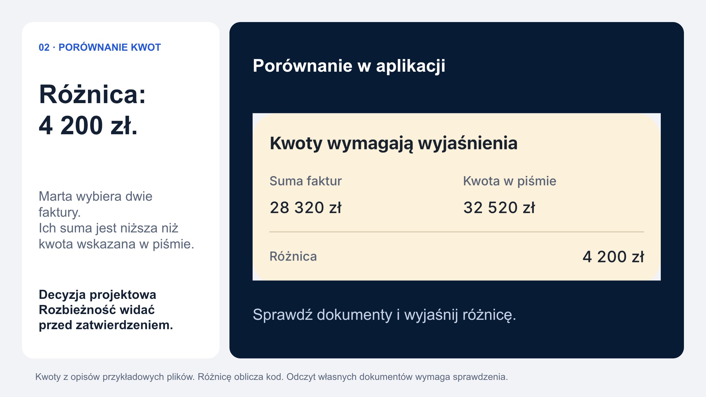

# mObywatel 2028

Klikalna koncepcja mObywatela, który przypomina o sprawie, pomaga zrozumieć pismo i przygotowuje następny krok. Obywatel sprawdza i zatwierdza.

[Wypróbuj opublikowaną aplikację](https://mobywatel.mateuszkozlowski.xyz) · [Badania](https://mobywatel.mateuszkozlowski.xyz/materialy.html)



## Jeden przykład

Marta dostaje pismo ze skarbówki. Bielik pomaga je zrozumieć. Przy odpowiedzi urząd i temat pochodzą z pisma, a wybrane faktury porównuje kod. Różnica 4 200 zł pojawia się przed zatwierdzeniem. Użytkownik może dołączyć brakujący dokument albo zmienić treść. Szkic jest odtwarzany w tej samej sesji pokazu.

Cztery fikcyjne profile obejmują również pojazdy, sprawy rodzinne, podejrzane wiadomości, udostępnienie wybranych danych i alarm z mapą punktu schronienia. Dokumenty i katalog usług pozostają dostępne bez czatu.

## Uruchomienie

Python 3.12 lub nowszy. Backend korzysta z biblioteki standardowej.

```sh
CIVIC_PUBLIC_DEMO=1 python3 serwer/server.py 8790
```

Otwórz http://127.0.0.1:8790/pokaz.html. Strona technologii: /technology.html. Landing jest główną prezentacją; PDF można pobrać ze stopki. Dawny adres /presentation.html przekierowuje na stronę główną. Wyniki i poprawki po badaniach: /materialy.html. Zwykłe wejście do pokazu zaczyna nową sesję; adres z `run` odtwarza poprzednią. Nie otwieraj samego HTML przez file://.

Bielik wymaga osobno skonfigurowanego API lub lokalnej Ollamy. Bez modelu można przeglądać interfejs i używać dostępnych formularzy. Szablon konfiguracji: [deploy/.env.example](deploy/.env.example). Nie wpisuj klucza w JavaScript ani do repozytorium. [Instrukcja hostingu](deploy/README.md).

OCR na macOS korzysta z PDFKit/Vision, na FreeBSD i Linuxie z Popplera i Tesseracta (pol+eng). Publiczny pokaz działa na istniejącym MyDevil MD1. Nie wymaga osobnego serwera GPU.

## Technologia i granice integracji

- **Bielik (SpeakLeash / ACK Cyfronet AGH)**: wyjaśnienia fikcyjnych pism, fragmenty szkiców i rozpoznanie potrzeby w znanym katalogu. Publicznie przez Public AI, operatora zagranicznego.
- **Kod aplikacji**: obliczenia Decimal, dobór znanego ekranu, porównanie źródeł i wybranych dokumentów.
- **CERT Polska / IMGW / KG PSP**: rzeczywiste publiczne źródła domen, ostrzeżeń i punktów schronienia.
- **Obywatel**: przegląd treści, załączników i odbiorcy. Model nie wysyła pisma samodzielnie.

Własny plik jest przesyłany do OCR na serwer. W wariancie Public AI jego treść nie trafia do modelu, a szkic powstaje według szablonu. Rozmowa z asystentem może trafić do API wraz z kontekstem i częścią wcześniejszych wypowiedzi. Wybrane pliki, odczytany tekst i szkice są też zapisywane w przeglądarce.

Podpis, Face ID, płatności, rejestry osobowe i czynności urzędowe są symulowane. Alarm jest scenariuszem. Obiekt w wykazie PSP nie oznacza potwierdzonego dostępu. Kontrole liczb i źródeł nie gwarantują semantycznej poprawności odpowiedzi modelu.

[Architektura i przepływ danych](docs/ARCHITECTURE.md) · [Weryfikacja](docs/VALIDATION.md) · [Pochodzenie materiałów](docs/ASSETS.md)

## Sprawdzenia

```sh
python3 -m unittest discover -s tests -v
python3 deploy/check_javascript.py
```

Testy korzystają z przygotowanych danych i atrap odpowiedzi. Nie wymagają klucza modelu. Testy uruchamiają się na GitHubie po każdym pushu. [Wyniki GitHub Actions](https://github.com/mateuszkozlowski/mobywatel-2028/actions/workflows/checks.yml).

Badania z 10 rzeczywistymi użytkownikami oraz analiza 10 person syntetycznych są osobnymi etapami. Publiczny wykres to opracowanie notatek z wcześniejszej wersji. Nie zmierzono jeszcze efektu poprawek.

## Licencja i autorstwo

Autor koncepcji i zmian: Mateusz Kozłowski. Projekt rozwija bazowy [prototyp mObywatel.ai](https://mobywatel.ai/) Janusza Cieszyńskiego. Kod bazowy i objęte nim zmiany są udostępnione zgodnie z zachowaną licencją [MIT](LICENSE). MIT nie obejmuje godła RP, nazwy i oznaczeń mObywatela, wyglądu dokumentów ani innych wyłączonych materiałów. Wykorzystanie tych oznaczeń w koncepcji nie jest udzieleniem praw do nich. Logotypy Bielika, CERT Polska, PSP i IMGW identyfikują model i źródła danych; nie są objęte MIT i nie oznaczają partnerstwa. Ich pochodzenie zapisano w [SOURCES.json](mockup/assets/technology/SOURCES.json). Profile i portrety w naszym pokazie są fikcyjne.


## Prywatne statystyki

Panel `/admin` pokazuje zakresy dat, odsłony, opcjonalny dzienny licznik przeglądarek, źródła ruchu, scenariusze, działania i czas aktywności. CSV wymaga logowania. Dane działań są agregatami, bez IP, treści spraw ani historii powiązanej z cookie. [Definicje pomiaru](docs/ANALYTICS.md).
